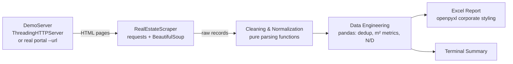
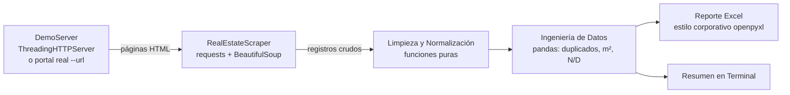

# 🏢 Real Estate Market Scraper

**Real estate listings extraction & price-per-m² analysis → corporate Excel report**
**Extracción de anuncios inmobiliarios y análisis de precio por m² → reporte Excel corporativo**


[English](#english) | [Español](#español)

---

## English

### 📌 Project Overview

**Real Estate Market Scraper** is a modular, production-style Python tool that crawls a real estate portal (sale and rental listings), cleans messy data and delivers an **analysis-ready Excel report** with the key investment metric: **price per square meter**.

Real estate portals publish data in inconsistent formats: `U$S 185.000`, `USD 1,250,000`, `$U 28.000 /mes`, `Sup. total: 300 mts²`, `120,5 m2`, `Monoambiente`, `Antigüedad: 15 años`… This project turns that noise into a clean, deduplicated and normalized dataset that investors, agencies and analysts can filter in seconds.

It ships with a **built-in DEMO server** (5 catalog pages with deliberately dirty data), so anyone — a recruiter or a client — can reproduce the full pipeline with a single command, without depending on external websites.

### 🏗️ Solution Architecture



| Layer | Component | Responsibility |
|---|---|---|
| 1. Config | `ScraperConfig`, `DEFAULT_SELECTORS` | Run parameters and CSS selectors (overridable via JSON) |
| 2. Demo | `DemoCatalog`, `DemoServer` | Local HTTP server with 5 pages of semi-dirty listings, duplicates and ad banners |
| 3. Extraction | `RealEstateScraper` | Session with realistic headers, retries with backoff, random delays (jitter), pagination via `rel="next"`, safe per-field extraction |
| 4. Cleaning | `parse_price`, `parse_number`, `parse_age`, … | Pure, testable functions: currencies, thousand/decimal separators, rooms, condition, building age |
| 5. Data Engineering | `build_dataframe`, `build_summary` | Discard invalid cards, deduplicate, compute price/m², USD normalization, `"N/D"` for nulls |
| 6. Reporting | `export_excel` | Corporate-styled `.xlsx` with two sheets |
| 7. CLI | `main`, `argparse` | `--demo` or `--url`, plus tuning flags |

### ✨ Key Features

- **Built-in DEMO server** – 100 % reproducible, zero external dependencies; auto-selects a free port.
- **Polite & robust scraping** – rotating realistic `User-Agent`, browser-like headers, random delays with jitter, automatic retries (429/5xx) with exponential backoff, loop protection on pagination.
- **Fault tolerant** – a missing field never stops the run; every field is extracted inside its own `try/except` and network errors are logged and counted.
- **Smart number parsing** – understands `185.000`, `1,250,000`, `120,5`, `1.234,56` and `1,234.56`.
- **Multi-currency** – detects `USD / U$S / US$` vs. local currency (`$U / UYU / $`) and normalizes to USD with a configurable exchange rate (`--fx-rate`).
- **Key metrics** – Price per m² (original currency), USD price, USD per m², building age in years, normalized property condition.
- **Deduplication** – by identical link **and** by title + location match (catches re-posted listings).
- **Corporate Excel report** – dark green header (`#1E4620`) with white bold text, Aptos 10 pt, thousand separators, auto-fit columns, frozen header (`A2`), auto-filters, clickable links, zebra rows, landscape print setup, plus a **"Resumen por Segmento"** sheet (average / median / min / max price per m² by operation, type and currency).
- **Configurable for real portals** – adapt to any site by editing a JSON selector file, no code changes.

### 📊 Extracted Fields / Report Columns

| Column | Description |
|---|---|
| Título | Listing title |
| Operación | `Venta` (sale) / `Alquiler` (rent) |
| Tipo de Propiedad | Apartamento, Casa, Terreno, Oficina |
| Barrio / Ciudad | Neighborhood and city |
| Moneda / Precio | Detected currency and numeric price |
| Superficie (m²) | Total area |
| **Precio por m²** | `Price / Area` (original currency) |
| Precio USD / **USD por m²** | Normalized to USD with `--fx-rate` |
| Dormitorios / Baños | Bedrooms (studio = 0) / bathrooms |
| Estado | A estrenar, Excelente, Muy bueno, Bueno, A reciclar, En construcción |
| Antigüedad (años) | Building age in years |
| Enlace | Clickable link to the listing |
| Página / Fecha de Extracción | Source page and timestamp |

### ⚙️ Installation

```bash
git clone https://github.com/<your-user>/real-estate-market-scraper.git
cd real-estate-market-scraper

python -m venv .venv
# Windows: .venv\Scripts\activate   |   macOS/Linux: source .venv/bin/activate

pip install -r requirements.txt
```

Requires **Python 3.10+**.

### 🚀 Usage

**DEMO mode (recommended first run):**

```bash
python scraper_inmobiliario.py --demo
```

**Real website:**

```bash
python scraper_inmobiliario.py --url "https://www.example-portal.com/properties?page=1" \
    --selectors selectores_ejemplo.json --max-pages 10 --fx-rate 40
```

**All options:**

| Flag | Default | Description |
|---|---|---|
| `--demo` | – | Run against the built-in local server |
| `--url URL` | – | First listing page of a real portal |
| `--selectors FILE` | built-in | JSON file with custom CSS selectors |
| `--max-pages N` | `5` | Maximum pages to crawl |
| `--delay-min` / `--delay-max` | `1.5` / `3.5` s (demo: `0.3` / `0.8`) | Random pause range between requests |
| `--fx-rate` | `40.0` | Local currency units per 1 USD |
| `--output FILE` | `reporte_mercado_inmobiliario.xlsx` | Output Excel path |
| `--port` | `0` (auto) | DEMO server port |
| `-v, --verbose` | off | DEBUG logging |

**Adapting to a real portal:** inspect the site with your browser DevTools, copy `selectores_ejemplo.json`, and replace each CSS selector (`card`, `title`, `link`, `price`, `area`, `next_page`, …). Unknown keys are ignored; missing keys fall back to defaults.

### 🖥️ Sample Terminal Output (DEMO)

```text
══════════════════════════════════════════════════════════════════
  📊  RESUMEN DE EJECUCIÓN · REAL ESTATE MARKET SCRAPER
══════════════════════════════════════════════════════════════════
  Páginas procesadas ............... 5
  Anuncios extraídos (brutos) ...... 60
  Descartados (inválidos) .......... 2
  Duplicados eliminados ............ 8
  Total consolidado ................ 50
  Errores de red/parsing ........... 0
  Sin precio publicado ............. 1
  Precio prom. m² · Venta .......... US$ 2,867.96   (28 anuncios)
  Precio prom. m² · Alquiler/mes ... US$ 12.08      (20 anuncios)
  (Normalizado a USD con TC 40 moneda local/USD)

  Precio promedio por m² por segmento (moneda original):
    • Alquiler  USD          9.90 /m²   (1 anuncio)
    • Alquiler  UYU        487.88 /m²   (19 anuncios)
    • Venta     USD      2,867.97 /m²   (28 anuncios)
══════════════════════════════════════════════════════════════════
```

> Sale and rental averages are reported separately on purpose: mixing them would produce a meaningless number.

### 📁 Project Structure

```text
real-estate-market-scraper/
├── scraper_inmobiliario.py          # Full pipeline (demo server, scraper, cleaning, report)
├── selectores_ejemplo.json          # Template for adapting to a real portal
├── requirements.txt
├── README.md
└── reporte_mercado_inmobiliario.xlsx  # Generated output
```

### ⚖️ Responsible Scraping

Always review the target site's **Terms of Service** and `robots.txt`, keep request rates low (the default delays are conservative), and prefer an official API when one exists. Do not collect personal data from listings.

### 📄 License

MIT — free to use and adapt.

[⬆ Back to top](#-real-estate-market-scraper)

---

## Español

### 📌 Visión General del Proyecto

**Real Estate Market Scraper** es una herramienta en Python, modular y con estándares de producción, que recorre un portal inmobiliario (anuncios de venta y alquiler), limpia datos desordenados y entrega un **reporte Excel listo para analizar** con la métrica clave para inversión: **el precio por metro cuadrado**.

Los portales publican datos en formatos inconsistentes: `U$S 185.000`, `USD 1,250,000`, `$U 28.000 /mes`, `Sup. total: 300 mts²`, `120,5 m2`, `Monoambiente`, `Antigüedad: 15 años`… Este proyecto convierte ese ruido en un dataset limpio, sin duplicados y normalizado, que inversionistas, inmobiliarias y analistas pueden filtrar en segundos.

Incluye un **servidor DEMO integrado** (5 páginas de catálogo con datos intencionalmente sucios), para que cualquier reclutador o cliente reproduzca el pipeline completo con un solo comando, sin depender de sitios externos.

### 🏗️ Arquitectura de la Solución



| Capa | Componente | Responsabilidad |
|---|---|---|
| 1. Configuración | `ScraperConfig`, `DEFAULT_SELECTORS` | Parámetros de ejecución y selectores CSS (sobrescribibles por JSON) |
| 2. Demo | `DemoCatalog`, `DemoServer` | Servidor HTTP local con 5 páginas de anuncios semi-sucios, duplicados y banners |
| 3. Extracción | `RealEstateScraper` | Sesión con headers realistas, reintentos con backoff, pausas aleatorias (jitter), paginación con `rel="next"`, extracción segura por campo |
| 4. Limpieza | `parse_price`, `parse_number`, `parse_age`, … | Funciones puras y testeables: monedas, separadores de miles/decimales, ambientes, estado, antigüedad |
| 5. Ingeniería de Datos | `build_dataframe`, `build_summary` | Descarte de tarjetas inválidas, deduplicación, precio/m², normalización a USD, `"N/D"` en nulos |
| 6. Reporte | `export_excel` | `.xlsx` corporativo con dos hojas |
| 7. CLI | `main`, `argparse` | `--demo` o `--url`, más parámetros de ajuste |

### ✨ Características Clave

- **Servidor DEMO integrado** – 100 % reproducible, sin dependencias externas; elige un puerto libre automáticamente.
- **Scraping respetuoso y robusto** – `User-Agent` realista rotativo, headers de navegador, pausas aleatorias con jitter, reintentos automáticos (429/5xx) con backoff exponencial y protección contra bucles de paginación.
- **Tolerante a fallos** – un campo faltante nunca detiene la ejecución: cada campo se extrae en su propio `try/except` y los errores de red se registran y contabilizan.
- **Parseo numérico inteligente** – entiende `185.000`, `1,250,000`, `120,5`, `1.234,56` y `1,234.56`.
- **Multimoneda** – detecta `USD / U$S / US$` frente a moneda local (`$U / UYU / $`) y normaliza a USD con un tipo de cambio configurable (`--fx-rate`).
- **Métricas clave** – Precio por m² (moneda original), precio en USD, USD por m², antigüedad en años y estado de la propiedad normalizado.
- **Deduplicación** – por enlace idéntico **y** por coincidencia de título + ubicación (detecta anuncios republicados).
- **Reporte Excel corporativo** – encabezado verde oscuro (`#1E4620`) con texto blanco en negrita, Aptos 10 pt, separador de miles, ancho de columnas auto-ajustado, encabezado congelado (`A2`), filtros automáticos, enlaces clicables, filas cebra, configuración de impresión horizontal y una hoja **"Resumen por Segmento"** (promedio / mediana / mínimo / máximo de precio por m² por operación, tipo y moneda).
- **Adaptable a portales reales** – se ajusta a cualquier sitio editando un JSON de selectores, sin tocar el código.

### 📊 Campos Extraídos / Columnas del Reporte

| Columna | Descripción |
|---|---|
| Título | Título del anuncio |
| Operación | `Venta` / `Alquiler` |
| Tipo de Propiedad | Apartamento, Casa, Terreno, Oficina |
| Barrio / Ciudad | Ubicación separada |
| Moneda / Precio | Moneda detectada y precio numérico |
| Superficie (m²) | Superficie total |
| **Precio por m²** | `Precio / Superficie` (moneda original) |
| Precio USD / **USD por m²** | Normalizado a USD con `--fx-rate` |
| Dormitorios / Baños | Dormitorios (monoambiente = 0) / baños |
| Estado | A estrenar, Excelente, Muy bueno, Bueno, A reciclar, En construcción |
| Antigüedad (años) | Antigüedad de la construcción |
| Enlace | Link clicable al anuncio |
| Página / Fecha de Extracción | Página de origen y fecha/hora |

### ⚙️ Guía de Instalación

```bash
git clone https://github.com/<tu-usuario>/real-estate-market-scraper.git
cd real-estate-market-scraper

python -m venv .venv
# Windows: .venv\Scripts\activate   |   macOS/Linux: source .venv/bin/activate

pip install -r requirements.txt
```

Requiere **Python 3.10+**.

### 🚀 Uso

**Modo DEMO (recomendado para la primera ejecución):**

```bash
python scraper_inmobiliario.py --demo
```

**Sitio web real:**

```bash
python scraper_inmobiliario.py --url "https://www.portal-ejemplo.com/propiedades?page=1" \
    --selectors selectores_ejemplo.json --max-pages 10 --fx-rate 40
```

**Todas las opciones:**

| Parámetro | Valor por defecto | Descripción |
|---|---|---|
| `--demo` | – | Ejecuta contra el servidor local integrado |
| `--url URL` | – | Primera página de listado de un portal real |
| `--selectors ARCHIVO` | integrados | JSON con selectores CSS personalizados |
| `--max-pages N` | `5` | Máximo de páginas a recorrer |
| `--delay-min` / `--delay-max` | `1.5` / `3.5` s (demo: `0.3` / `0.8`) | Rango de pausa aleatoria entre solicitudes |
| `--fx-rate` | `40.0` | Unidades de moneda local por 1 USD |
| `--output ARCHIVO` | `reporte_mercado_inmobiliario.xlsx` | Ruta del Excel de salida |
| `--port` | `0` (automático) | Puerto del servidor DEMO |
| `-v, --verbose` | desactivado | Logs en nivel DEBUG |

**Adaptación a un portal real:** inspecciona el sitio con las DevTools del navegador, copia `selectores_ejemplo.json` y reemplaza cada selector CSS (`card`, `title`, `link`, `price`, `area`, `next_page`, …). Las claves desconocidas se ignoran; las faltantes usan los valores por defecto.

### 🖥️ Ejemplo de Salida en Terminal (DEMO)

```text
══════════════════════════════════════════════════════════════════
  📊  RESUMEN DE EJECUCIÓN · REAL ESTATE MARKET SCRAPER
══════════════════════════════════════════════════════════════════
  Páginas procesadas ............... 5
  Anuncios extraídos (brutos) ...... 60
  Descartados (inválidos) .......... 2
  Duplicados eliminados ............ 8
  Total consolidado ................ 50
  Errores de red/parsing ........... 0
  Sin precio publicado ............. 1
  Precio prom. m² · Venta .......... US$ 2,867.96   (28 anuncios)
  Precio prom. m² · Alquiler/mes ... US$ 12.08      (20 anuncios)
  (Normalizado a USD con TC 40 moneda local/USD)

  Precio promedio por m² por segmento (moneda original):
    • Alquiler  USD          9.90 /m²   (1 anuncio)
    • Alquiler  UYU        487.88 /m²   (19 anuncios)
    • Venta     USD      2,867.97 /m²   (28 anuncios)
══════════════════════════════════════════════════════════════════
```

> Los promedios de venta y alquiler se informan por separado a propósito: mezclarlos produciría una cifra sin sentido.

### 📁 Estructura del Proyecto

```text
real-estate-market-scraper/
├── scraper_inmobiliario.py          # Pipeline completo (servidor demo, scraper, limpieza, reporte)
├── selectores_ejemplo.json          # Plantilla para adaptar a un portal real
├── requirements.txt
├── README.md
└── reporte_mercado_inmobiliario.xlsx  # Archivo generado
```

### ⚖️ Scraping Responsable

Revisa siempre los **Términos de Servicio** y el `robots.txt` del sitio objetivo, mantén una frecuencia de solicitudes baja (las pausas por defecto son conservadoras) y prefiere una API oficial cuando exista. No recolectes datos personales de los anuncios.

### 📄 Licencia

MIT — libre para usar y adaptar.

[⬆ Volver arriba](#-real-estate-market-scraper)
